# Zautomatyzowana linia produkcyjna – Factory I/O + TIA Portal + S7-PLCSIM

Wirtualny model w pełni zautomatyzowanej linii produkcyjnej sterowanej wirtualnym sterownikiem **Siemens S7-1200**. Projekt powstał jako praca inżynierska (Politechnika Rzeszowska im. I. Łukasiewicza, Wydział Elektrotechniki i Informatyki, 2026) i demonstruje **wirtualny rozruch (virtual commissioning)** z użyciem cyfrowego bliźniaka linii.

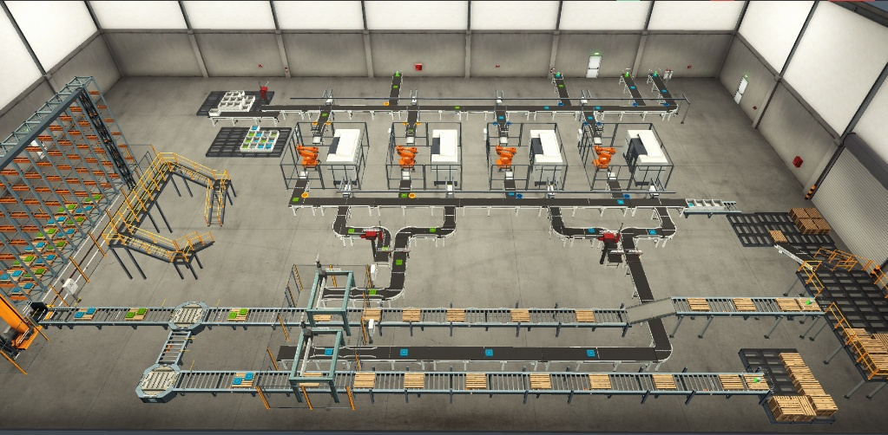

## Demo

[](https://youtu.be/9cgSY0ow9To)

Film pokazujący działanie całej linii: **https://youtu.be/9cgSY0ow9To**

---

## Spis treści

- [Demo](#demo)
- [Opis projektu](#opis-projektu)
- [Zakres i funkcjonalności](#zakres-i-funkcjonalności)
- [Użyte technologie](#użyte-technologie)
- [Architektura systemu](#architektura-systemu)
- [Cykl produkcyjny](#cykl-produkcyjny)
- [Elementy linii (galeria)](#elementy-linii-galeria)
- [Konfiguracja projektu](#konfiguracja-projektu)
- [Komunikacja TIA Portal ↔ Factory I/O (PEEK & POKE)](#komunikacja-tia-portal--factory-io-peek--poke)
- [Mapowanie wejść i wyjść](#mapowanie-wejść-i-wyjść)
- [Program sterujący (LAD)](#program-sterujący-lad)
- [Uruchomienie krok po kroku](#uruchomienie-krok-po-kroku)
- [Struktura repozytorium](#struktura-repozytorium)
- [Wnioski i napotkane problemy](#wnioski-i-napotkane-problemy)
- [Możliwe usprawnienia](#możliwe-usprawnienia)
- [Autor](#autor)

---

## Opis projektu

Przed zbudowaniem fizycznej linii warto zamodelować jej wirtualny odpowiednik. Pozwala to:

1. wykryć błędy konstrukcyjne,
2. testować różne rozwiązania,
3. optymalizować koszty i rozmieszczenie stanowisk,
4. zweryfikować kolizje.

Celem projektu było zaprojektowanie i uruchomienie wirtualnego modelu linii w środowisku **Factory I/O**, sterowanego programem napisanym w języku drabinkowym **LAD** w **TIA Portal**, z użyciem symulatora **S7-PLCSIM**.

## Zakres i funkcjonalności

- Model 3D linii: taśmociągi, czujniki, siłowniki, roboty, magazyn wysokiego składowania
- Komunikacja Factory I/O ↔ S7-PLCSIM ↔ TIA Portal
- Program sterujący w **LAD** (+ blok synchronizujący w **SCL**)
- Lista zmiennych (PLC tags) – ponad **280 zmiennych**, spójne nazewnictwo w obu środowiskach
- Panel operatorski: Start / Stop / Reset / Emergency Stop, kolumna sygnalizacyjna, syrena alarmowa
- Sortowanie detali (czujniki + pushery, przerzutniki SR)
- Zrobotyzowana obróbka CNC (4 centra obróbcze)
- Montaż bazy i pokrywy (manipulator Two-Axis Pick & Place)
- Paletyzacja manipulatorem XYZ ze sterowaniem **analogowym (REAL)**
- Logistyka palet (przenośniki rolkowe, obrotnice)
- Automatyczny magazyn wysokiego składowania (układnica, licznik pozycji, kaskada timerów)

## Użyte technologie

| Element | Wersja / model |
|---|---|
| Środowisko inżynierskie | Siemens **TIA Portal V16** |
| Sterownik (wirtualny) | **S7-1200, CPU 1211C AC/DC/Rly** (6ES7 211-1BE40-0XB0), FW **V4.2** |
| Symulator sterownika | **S7-PLCSIM** |
| Symulacja 3D | **Factory I/O** (sterownik: *Siemens S7-PLCSIM*) |
| Języki programowania | LAD, SCL |

## Architektura systemu

```
┌──────────────┐      ┌──────────────┐      ┌──────────────────┐
│  TIA Portal  │ ───► │  S7-PLCSIM   │ ◄──► │   Factory I/O    │
│ (LAD + SCL)  │      │ wirtualny PLC│      │ symulacja 3D linii│
└──────────────┘      └──────────────┘      └──────────────────┘
```

System działa w zamkniętej pętli sprzężenia zwrotnego:

1. sterownik odczytuje sygnały wejściowe `%I` (czujniki optyczne, pozycji, enkodery),
2. wykonuje program LAD (liczniki, timery, komparatory),
3. ustawia wyjścia `%Q`.

Zastosowano rozwiązanie **hybrydowe**: proste elementy wykonawcze (silniki taśm, siłowniki) sterowane są sygnałami binarnymi, a bardziej złożone urządzenia (manipulator XYZ, układnica) – wartościami `REAL` / `DWORD`.

## Cykl produkcyjny

1. **Wprowadzenie i selekcja** – „Emitter” generuje detale, czujniki wizyjne (Vision Sensor) identyfikują typ, pushery kierują wybrane elementy na tory boczne.
2. **Obróbka CNC** – roboty pobierają detal i umieszczają go w centrum obróbczym (2 maszyny produkują bazy, 2 w trybie „Produce Lids” – pokrywy).
3. **Dystrybucja do montażu** – kontrola po obróbce, kolejne sortowanie.
4. **Montaż** – Two-Axis Pick & Place łączy bazę i pokrywę w jeden produkt (pozycjonery/clamps centrują detale).
5. **Paletyzacja** – manipulator XYZ odkłada gotowe wyroby na paletę (po 2 sztuki).
6. **Magazynowanie** – paleta trafia przez obrotnice do magazynu wysokiego składowania, gdzie układnica umieszcza ją w kolejnym wolnym gnieździe.


## Elementy linii (galeria)

**Panel operatorski** – Start / Stop / Reset / Emergency Stop, kolumna sygnalizacyjna i syrena alarmowa.

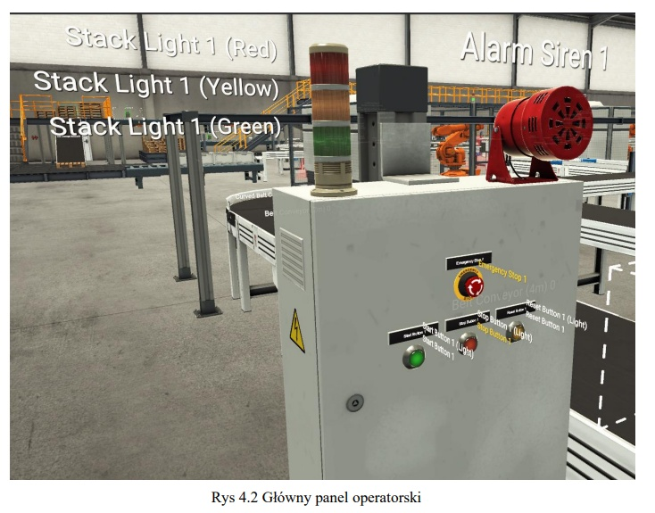

**Sortowanie** – czujnik wizyjny (Vision Sensor) i pneumatyczne popychacze kierujące detale do strefy obróbki.

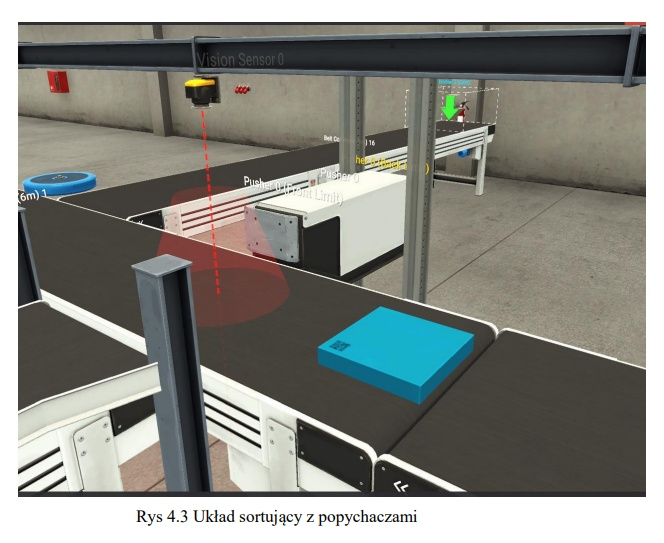

**Obróbka** – zrobotyzowane gniazda z centrami obróbczymi (2× bazy, 2× pokrywy).

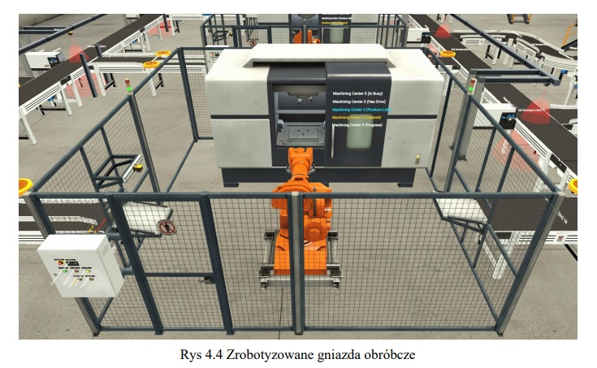

**Montaż** – Two-Axis Pick & Place z pozycjonerami (clamps) i czujnikami Diffuse Sensor.

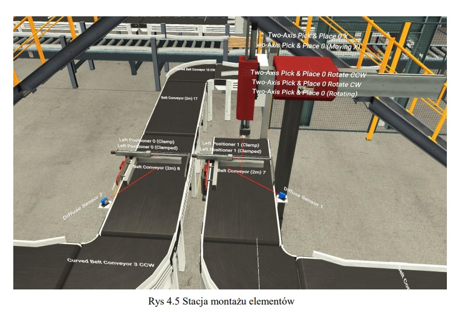

**Paletyzacja** – manipulator XYZ sterowany wartościami analogowymi (REAL).

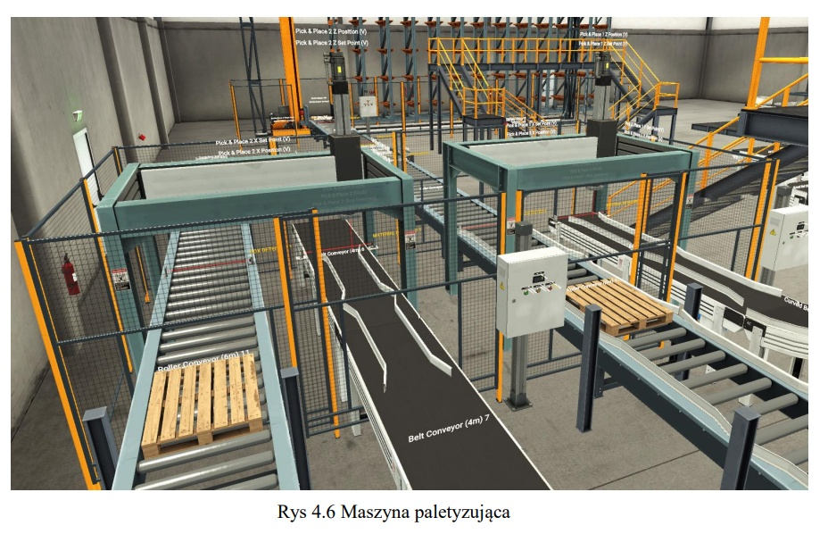

**Logistyka palet** – przenośniki rolkowe i obrotnice (Turntables).

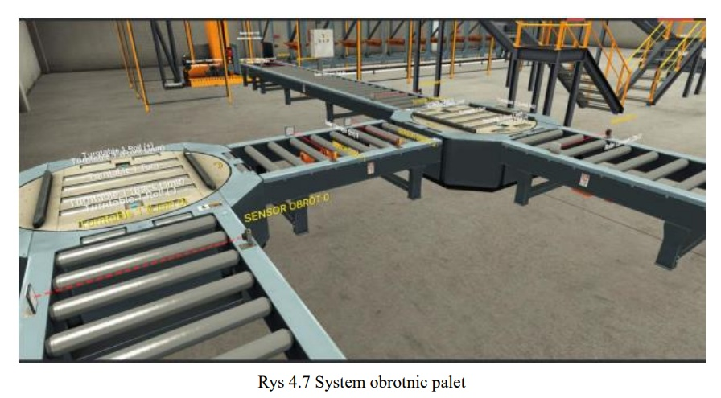

**Magazyn wysokiego składowania** – układnica i przenośnik załadowczy.

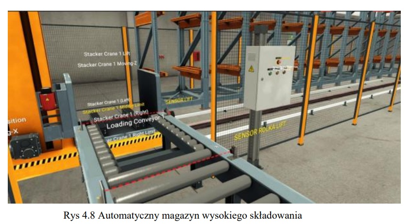

---

## Konfiguracja projektu

### TIA Portal
- Utworzenie projektu w TIA Portal V16
- Dodanie urządzenia: **Controllers → SIMATIC S7-1200 → CPU 1211C AC/DC/Rly → 6ES7 211-1BE40-0XB0**
- Wersja firmware: **V4.2** (wymagana do współpracy z symulatorem)
- Program zawiera m.in. `Main [OB1]` oraz blok `PEEK AND POKE S71200 [FC9000]`

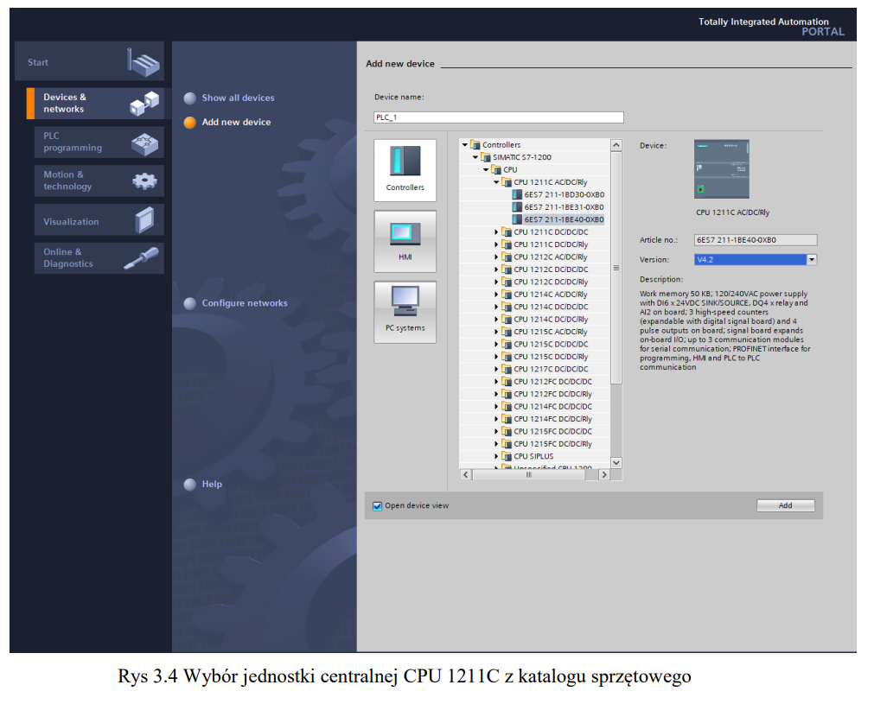
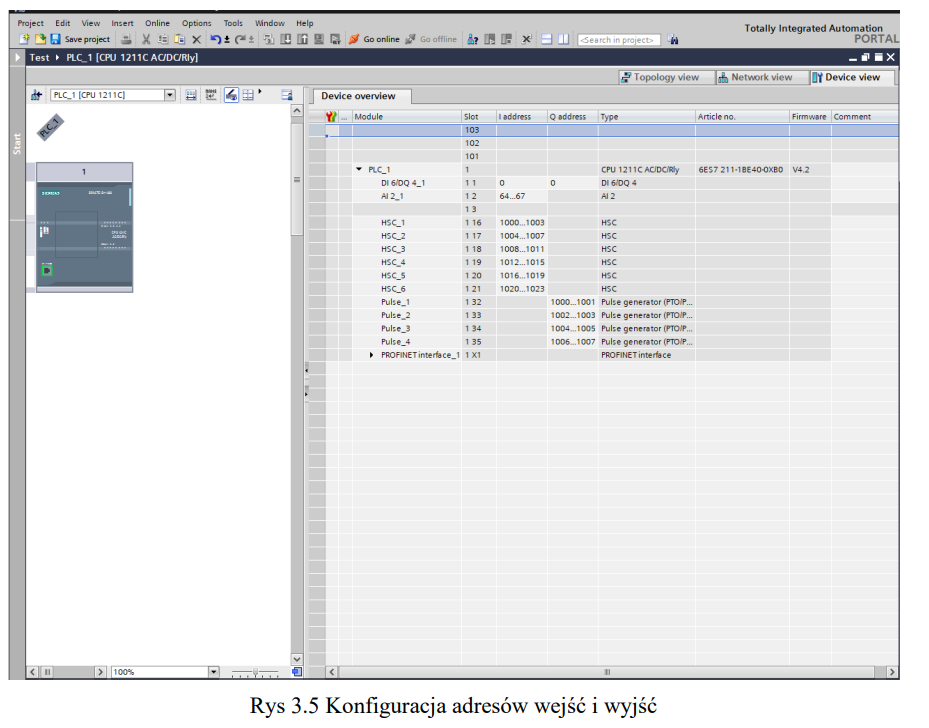
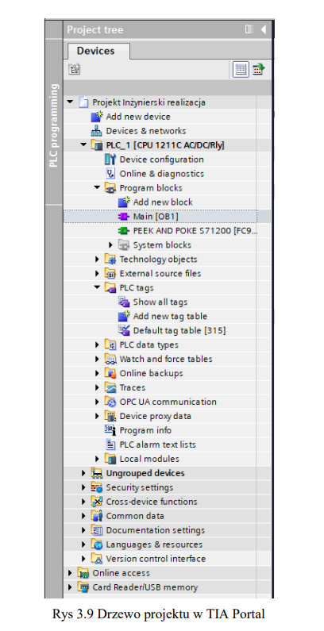

### Factory I/O – ustawienia sterownika (Siemens S7-PLCSIM)

| Parametr | Wartość |
|---|---|
| Numerical Data Type | `DWORD` |
| Bool Inputs | offset `0`, count `155` |
| Bool Outputs | offset `0`, count `220` |
| DWORD Inputs | offset `30`, count `8` |
| DWORD Outputs | offset `30`, count `8` |

**Dlaczego offset 30?** Sygnały binarne (>280) zajmują początkowe bajty pamięci (od `%I0.0` i `%Q0.0`). Rozpoczęcie adresowania wartości 32-bitowych (pozycje robotów) od zera nadpisałoby stany przycisków i czujników. Offset 30 tworzy bezpieczny odstęp między sygnałami cyfrowymi a analogowymi (np. `%QD30`, `%QD34`, `%QD38`).

> **Znany problem:** domyślny zakres wyjść `%Q1.0 – %Q7.0` nie był prawidłowo obsługiwany przez symulator (tzw. „martwa strefa” – wyjścia bez reakcji). Rozwiązaniem było przesunięcie adresacji używanych wyjść poza ten zakres w ustawieniach Factory I/O.


## Komunikacja TIA Portal ↔ Factory I/O (PEEK & POKE)

Kluczowym elementem integracji jest dedykowany blok funkcyjny napisany w **SCL**, realizujący funkcje **PEEK** i **POKE**. Standardowa wymiana danych z PLCSIM bywa niewystarczająca dla płynnej symulacji fizyki w Factory I/O, dlatego blok:

- **PEEK** – bezpośrednio odczytuje bity/bajty z obszaru pamięci symulatora (z pominięciem standardowego bufora procesu),
- **POKE** – natychmiast zapisuje dane do obszaru pamięci wyjściowej,
- w pętli `FOR` przepisuje stany z offsetowanych adresów symulatora na wewnętrzne obszary pamięci,
- synchronizuje cykl czasowy sterownika z symulacją.

Blok jest wywoływany w **Network 1** na samym początku `Main [OB1]`, dzięki czemu cała dalsza logika działa na najświeższych stanach sygnałów z modelu 3D. Warstwa komunikacyjna jest oddzielona od warstwy logicznej, co ułatwia diagnostykę.

```pascal
// Inicjalizacja wskaźników pamięci
#Value := PEEK(area := 16#82,
               dbNumber := 0,
               byteOffset := 511);
#Value := #Value + 1;

// Zapis wartości kontrolnych
POKE(area := 16#82,
     dbNumber := 0,
     byteOffset := 511,
     value := #Value);

POKE(area := 16#81,
     dbNumber := 0,
     byteOffset := 1016,
     value := #Value_01_DW);

POKE(area := 16#81,
     dbNumber := 0,
     byteOffset := 1020,
     value := #Value_02_DW);

POKE(area := 16#81,
     dbNumber := 0,
     byteOffset := 511,
     value := B#16#00);

// Pętla opóźniająca dla synchronizacji czasu
FOR #forVal := 0 TO 120 DO
    FOR #forVal_2 := 0 TO 10 DO
        #rdTimeReturn := RD_SYS_T(#outputTime);
        #rdTimeReturn := WR_SYS_T(#outputTime);
        #rdTimeReturn := RD_SYS_T(#outputTime);
        #rdTimeReturn := WR_SYS_T(#outputTime);
    END_FOR;

    #SyncVal := PEEK(area := 16#81,
                     dbNumber := 0,
                     byteOffset := 511);

    // Warunek wyjścia z pętli
    IF #SyncVal = #CompVal THEN
        // Wykonanie akcji kończącej
        POKE(area := 16#81,
             dbNumber := 0,
             byteOffset := 511,
             value := B#16#0);
        // Przerwanie pętli
        EXIT;
    END_IF;
END_FOR;
```

> Pełny kod bloku znajduje się w pliku `src/scl/peek_poke.scl` *(uzupełnij ścieżkę)*.

## Mapowanie wejść i wyjść

Nazwy zmiennych w TIA Portal są **identyczne** z nazwami elementów w Factory I/O, co upraszcza mapowanie i diagnostykę. Projekt obejmuje ponad 280 zmiennych:

| Typ | Rozmiar | Zastosowanie | Przykładowy adres |
|---|---|---|---|
| `BOOL` | 1 bit | czujniki, przyciski, cewki zaworów i silników | `%I0.0`, `%Q0.0` |
| `REAL` | 32 bit | pozycje X/Y/Z manipulatora | `%QD30`, `%QD34`, `%QD38` |
| `DINT` | 32 bit | liczniki dużej pojemności, numery palet | `%QD54`, `%QD58` |
| Marker | 1 bit | logika sekwencyjna, stany maszyny | `%M0.0` |

Przykładowe tagi:

| Nazwa | Typ | Adres |
|---|---|---|
| START BUTTON 1 | Bool | `%I0.0` |
| STOP BUTTON 1 | Bool | `%I0.1` |
| SENSOR 0 | Bool | `%I0.2` |
| PUSHER 0 (Front Limit) | Bool | `%I1.2` |
| TASMA (4M) 0 | Bool | `%Q0.0` |
| PUSHER 0 | Bool | `%Q22.4` |

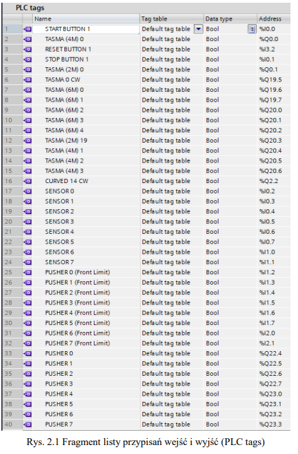

## Program sterujący (LAD)

| Network | Funkcja |
|---|---|
| **1** | Wywołanie `PEEK AND POKE S71200` (synchronizacja z Factory I/O) |
| **2** | Start/Stop z samopodtrzymaniem (`%M0.0 "RUN"`), E-Stop, stack light, syrena alarmowa |
| **3** | Grupowe zasilanie taśm, rolek i emiterów sygnałem `%M2.2 "Zasilanie"` |
| **5** | Sortowanie – 8 pusherów sterowanych przerzutnikami **SR** (Set: czujnik, Reset: krańcówka *Front Limit*) |
| **6** | Nadzór nad centrami obróbczymi (`RUN` + lokalne `STOP BUTTON 6/7`) |
| **8** | Montaż – zatrzymanie taśm, pozycjonery, sekwencja X-Z sterowana timerami **TON** |
| **11–12** | Pick & Place XYZ – bloki `MOVE` (REAL), komparatory z tolerancją, chwytak `GRAB`, licznik **CTU** |
| **24–26** | Magazyn wysokiego składowania – licznik pozycji (`CTU`), kaskada timerów (`TP`/`TON`), sterowanie układnicą |

Po załadowaniu programu do **S7-PLCSIM** i przełączeniu w tryb RUN można podglądać stany styków i cewek w czasie rzeczywistym (*Monitoring on/off*).

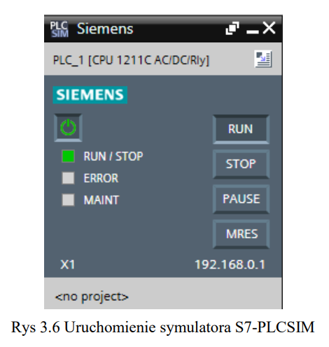
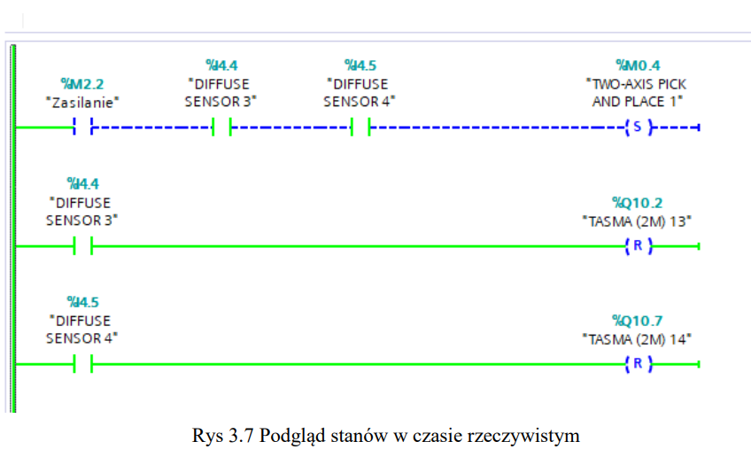

### Najważniejsze mechanizmy

**Start / Stop / bezpieczeństwo** – marker `%M0.0 "RUN"` jest podtrzymywany i stanowi warunek dla pozostałych części programu. Naciśnięcie `STOP BUTTON 1` lub grzyba `EMERGENCY STOP 1` natychmiast wyłącza linię; zielona/czerwona lampka sygnalizuje stan, a E-Stop uruchamia syrenę.

**Sortowanie (SR)** – pusher wysuwa się po wykryciu detalu i wraca dopiero po aktywacji krańcówki *Front Limit*, niezależnie od długości sygnału z czujnika.

**Manipulator XYZ** – ruch tylko gdy spełnione są jednocześnie warunki (`RUN` ∧ `BOX DETECTED 0` ∧ `MATERIAL DETECTED 0`). Współrzędne zadawane blokami `MOVE` do `%QD30/34/38`, a osiągnięcie pozycji weryfikowane komparatorami REAL, np. dla punktu pobrania: `X ∈ [0.88; 0.92]`, `Y ∈ [0.19; 0.21]`. Dopiero potem opuszczana jest oś Z i załączany chwytak.

**Magazyn** – licznik `CTU "ŁadowanieCTU"` zlicza palety i jest przepisywany do `%QD58 "CRANE 1 Target Position"`, dzięki czemu kolejne palety trafiają do kolejnych wolnych gniazd. Sekwencja: wysuw wideł → podniesienie → wycofanie → dojazd → wysuw → opuszczenie → powrót.


## Uruchomienie krok po kroku

### Wymagania
- Siemens **TIA Portal V16** (z **S7-PLCSIM**)
- **Factory I/O** (z dostępnym sterownikiem *Siemens S7-PLCSIM*)
- Windows

### Instrukcja

1. **Sklonuj repozytorium**
   ```bash
   git clone https://github.com/<twoj-login>/<nazwa-repo>.git
   ```
2. **Otwórz projekt** w TIA Portal (`*.ap16`).
3. **Uruchom S7-PLCSIM** i naciśnij **Power On**.
4. W TIA Portal: **Online → Extended download to device**
   - typ urządzenia: `S7-1200`, interfejs: `PLCSIM`,
   - **Start search** → **Load**.
5. Przełącz sterownik w tryb **RUN**.
6. **Otwórz scenę** w Factory I/O (`factoryio/scene.factoryio`) i ustaw sterownik **Siemens S7-PLCSIM** zgodnie z [tabelą konfiguracji](#factory-io--ustawienia-sterownika-siemens-s7-plcsim).
7. Uruchom symulację i naciśnij **Start Button 1** na panelu operatorskim.
8. Magazyn wysokiego składowania uruchamiany jest **oddzielnie** przyciskiem **Start Button 4** (lokalny panel).
9. Opcjonalnie włącz **Monitoring on/off** (ikona okularów) w TIA Portal, aby podglądać stany styków w czasie rzeczywistym.

### Obsługa panelu

| Element | Działanie |
|---|---|
| Start Button 1 | uruchomienie cyklu produkcyjnego (zielona lampka) |
| Stop Button 1 | zatrzymanie linii (czerwona lampka) |
| Emergency Stop 1 | stan awaryjny, odcięcie zasilania, syrena + pulsujące światło |
| Start Button 4 | start magazynu |
| Stop Button 5 | zatrzymanie układnicy |
| Reset Button Lift | zerowanie licznika zapełnienia magazynu |

## Struktura repozytorium

> Dostosuj do rzeczywistej zawartości repozytorium.

```
.
├── README.md
├── tia-portal/            # projekt TIA Portal V16
├── factoryio/             # scena Factory I/O
├── src/
│   └── scl/
│       └── peek_poke.scl  # blok synchronizujący PEEK & POKE
├── docs/
│   ├── images/            # zrzuty ekranu
│   └── Zautomatyzowana_linia_produkcyjna.pdf   # pełna praca
└── LICENSE
```

## Wnioski i napotkane problemy

- **Wirtualny rozruch** pozwala wcześnie wykryć błędy logiczne (np. kolizje), które w rzeczywistości mogłyby uszkodzić maszyny i spowodować przestoje.
- **Integracja systemów** – standardowa wymiana danych bywa niewystarczająca; blok SCL z PEEK/POKE zapewnił synchronizację i wyeliminował opóźnienia sygnałów.
- **Sterowanie maszynami** – sterowanie binarne nie daje wymaganej dokładności; sterowanie analogowe (`REAL` + `MOVE`) umożliwiło precyzyjne pozycjonowanie manipulatora i układnicy.
- **Logika sekwencyjna** – kaskady timerów TON i liczniki działają, ale tworzenie kodu bez wcześniejszego modelu formalnego (np. grafu automatu) zwiększa ryzyko błędów.

## Możliwe usprawnienia

- Indywidualne sterowanie każdą taśmą na podstawie lokalnych czujników (zamiast grupowego zasilania `%M2.2`) – lepsza efektywność energetyczna i żywotność napędów
- Zamodelowanie sekwencji w formie grafu stanów (GRAFCET / SFC) przed implementacją
- Dodanie wizualizacji HMI / SCADA
- Sprzężenie magazynu z głównym sygnałem startu linii

## Autor

**<Imię i nazwisko>** – praca inżynierska, Politechnika Rzeszowska im. I. Łukasiewicza, Wydział Elektrotechniki i Informatyki, 2026.

- GitHub: [@twoj-login](https://github.com/twoj-login)
- Kontakt: *twoj@email.pl*

## Licencja

*Uzupełnij (np. MIT) lub usuń tę sekcję.*
